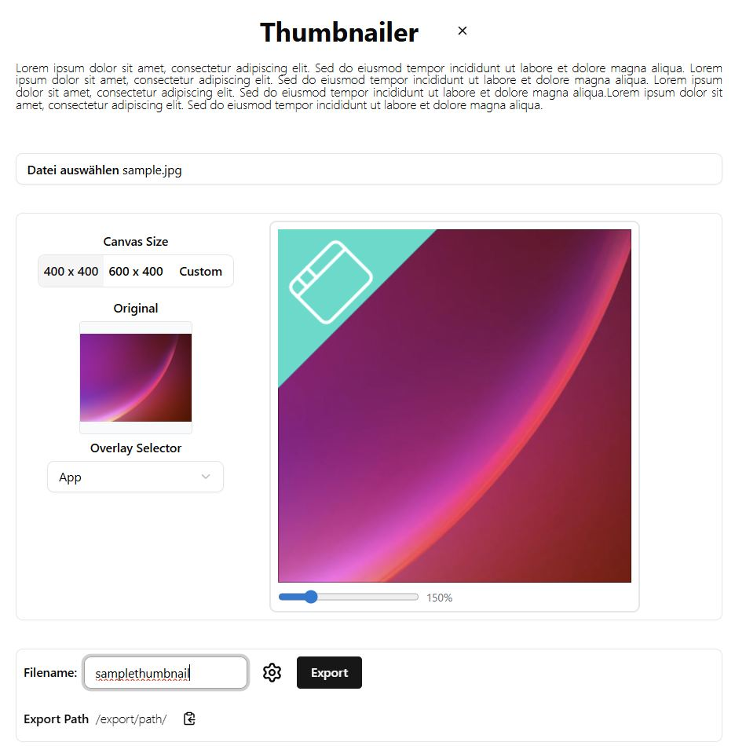
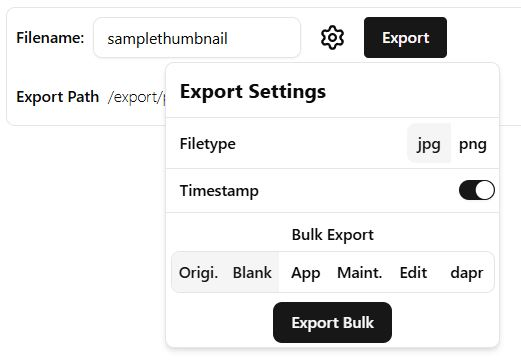

# Thumbnailer

Small, browser-based thumbnail generator built with React + TypeScript. Upload an image, preview overlays, pick canvas sizes and export single or bulk thumbnails.




## Features
- Live preview canvas with multiple overlay types. Add to your liking.
- Export single image or bulk exports with configured overlays
- Filename, format (`jpg` / `png`) and optional timestamp suffix
- Overlays, canvas sizes, logo, favicon and export defaults are configurable via JSON, no code changes needed

## Quick start
```bash
npm install
npm run dev
npm run build   # output in dist/
```
The build uses a relative base (`./`), so `dist/` can be deployed to any folder or subfolder (e.g. an IIS virtual directory) without rebuilding.

## Customization
All company/project specific stuff lives in **`public/custom/`**:

```
public/custom/
  config.json    <- your overrides (start from config.example.json)
  logo.svg       <- your assets, referenced as "custom/logo.svg"
```

`custom/config.json` is loaded at runtime and merged over the defaults + sample overlays in `src/config/defaultConfig.ts` (objects are deep-merged, arrays are replaced). It is optional; without it the defaults are used.

| Key | Description |
|---|---|
| `info.title`, `info.text`, `info.showText` | Header title and info text |
| `info.logo`, `info.favicon` | Logo next to the title, favicon |
| `export.*` | Default filename, format, timestamp, preselected bulk overlays (`"original"`, `"none"` or overlay ids) |
| `exportPath.*` | Hint box showing where exports should go |
| `canvasSizes` | `[{ "width": 400, "height": 400, "label"?: "..." }]`, the first one is the initial size |
| `overlays` | Replaces the sample overlays |
| `overlaysAppend` | Adds overlays to the existing list |

### Overlays
An overlay is a list of layers drawn in order:

| Layer | Fields |
|---|---|
| `triangle` | `corner` (`tl`/`tr`/`bl`/`br`), `size` (default 180), `color` |
| `icon` | `src`, `size` or `width`+`height` (image is fit into the box), `fill` / `stroke` (recolor SVG) |
| `text` | `text`, `font` (default `bold 28px sans-serif`), `color` (default white) |

`icon` and `text` are positioned by their center: `anchor` (`tl`/`tr`/`bl`/`br`/`center`, default `tl`), `x`/`y` offset inward from the anchor, and `rotate` in degrees.

See [`public/custom/config.example.json`](public/custom/config.example.json) for a full example.

## Using it in your company (fork workflow)
```bash
git clone <your-company-remote> thumbnailer && cd thumbnailer
git remote add upstream https://github.com/Zwebelee/thumbnailer.git
# add public/custom/config.json + assets. public/custom/ is gitignored upstream,
# so force-add new files once (afterwards they are tracked normally)
git add -f public/custom/config.json public/custom/logo.svg
git commit -m "company customization" && git push
```
Updating:
```bash
git fetch upstream
git merge upstream/main
```
Rules that keep merges conflict-free:
- Only commit to `public/custom/`.
- Generic fixes or features: open a PR upstream, then pull them back. Don't patch core files in the fork.
- If something can't be configured yet, add the config option upstream instead of hardcoding it in the fork.
